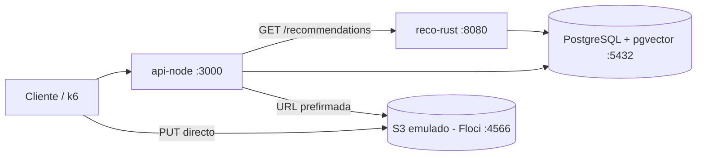

# The Social Network: red social para creadores de contenido

Plataforma que recomienda contenido de creadores usando similitud de vectores.
Motor de recomendaciones en **Rust** sobre **PostgreSQL + pgvector**, API en **Node.js** y archivos multimedia en **S3**.

> En construccion: MVP local de 8 sesiones. El plan esta en el documento "Plan de 8 dias".

## Arquitectura



## Requisitos

- Docker Desktop
- Rust (rustup) y Node.js 22
- Terraform + tflocal, AWS CLI + awslocal (dia 6)
- k6 (dia 8)

## Arranque

```bash
cp .env.example .env          # en PowerShell: Copy-Item .env.example .env
docker compose up -d
docker compose ps             # postgres "healthy" y floci arriba
```

La primera vez, Postgres crea el esquema y carga datos sinteticos (`db/`), unos 10 a 30 segundos.
Para empezar de cero: `docker compose down -v && docker compose up -d`.

Comprobar los datos:

```bash
docker exec -it tsn-postgres psql -U tsn -d tsn -c "select count(*) from content;"
```

## Estructura

| Carpeta | Contenido |
| --- | --- |
| `db/` | Esquema y seed (se ejecutan al crear el contenedor) |
| `reco-rust/` | Servicio de recomendaciones (dias 2 a 4) |
| `api-node/` | API REST (dias 5 y 6) |
| `infra/` | Terraform del bucket S3 (dia 6) |
| `loadtest/` | Pruebas de carga con k6 (dia 8) |
| `docs/original/` | Requerimientos y esqueleto original del proyecto |

## Resultados

Pendiente (dias 7 y 8): latencia con y sin indice HNSW, calidad de las recomendaciones frente al azar y resultados de k6.
