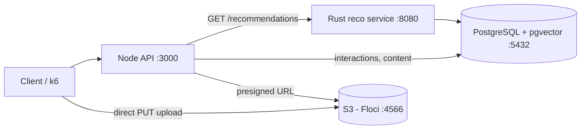
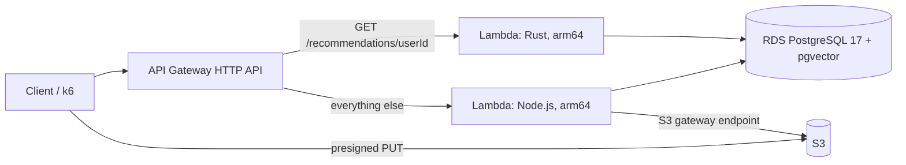

# The Social Network: content recommendations for creators

A social network backend that recommends creators' content by **vector similarity**.
A **Rust** service finds each user's nearest content with **PostgreSQL + pgvector**, a **Node.js** API handles
interactions and content, and media files go straight to **S3** through presigned URLs.

Built as a local MVP in 8 one-hour sessions ([plan](docs/PLAN.md)), then deployed to AWS in 4 more
([phase 2](docs/PHASE2.md)): Lambda, API Gateway, RDS PostgreSQL + pgvector and S3, all with Terraform.
Locally everything runs on Docker, with S3 emulated by [Floci](https://github.com/hectorvent/floci).

## Results

Measured locally with 100,000 content items and 10,000 users ([details and how to reproduce](docs/results.md)).

| What | Result |
| --- | --- |
| Nearest-neighbor query, no index | 36.8 ms |
| Nearest-neighbor query, HNSW index | **3.9 ms** (9.4x faster) |
| Top-10 hits in the user's preferred category | **100%** vs 5% random |
| Highest load meeting p95 < 150 ms, p99 < 200 ms, 0 errors | **400 req/s** (p99 19.3 ms) |
| Saturation point | ~800 req/s (p99 281 ms, no errors) |
| Collapse | 1,000 req/s (throughput falls to 615 req/s, 1.13% errors) |
| Tests | 4 Rust unit tests, 4 Node integration tests |
| A/B test, recommended vs chronological feed (1,000 simulated users) | CTR **23.71% vs 3.68%** (+545%); see caveat below |
| **AWS:** Rust Lambda warm duration / memory | **14-19 ms / 17 MB** (Node Lambda: 130 MB) |
| **AWS:** healthy load from a laptop in Mexico | **100 req/s**, p50 102 ms (mostly network), 0 errors |
| **AWS:** first breaking point | 200 req/s: database connection storm (Lambda concurrency hit 400, RDS 206 connections, 60% errors) |
| **AWS:** after capping Lambda concurrency at 25 | 200 req/s with p50 105 ms, 1.1% errors (fast throttles); 300 req/s with 2.0% |
| **AWS:** ceiling with a 60-instance cap (2,000 req/s target) | ~580 successful req/s; at 1,000 req/s 41.6% throttled, 0 Lambda errors; target not reached |

On AWS, the limit was not the database CPU but **connections**: every new Lambda instance opens its own. Capping the
Rust Lambda at 25 concurrent instances (one connection each) fixed it: errors at 200 req/s fell from 60% to 1.1%.
RDS Proxy is the next step. Full analysis in [docs/results.md](docs/results.md#aws-deployment-phase-2).

The A/B test measures engagement with logged impressions and clicks; its users are simulated and click on the same
signal the recommender uses, so the result validates the measurement pipeline rather than real-world impact.

The quality number comes from synthetic data with perfectly separated categories: it shows the pipeline works end
to end, not real-world quality. The load test shares one laptop between k6 and all services.

## How it works



**Recommendations** (`GET /recommendations/{userId}`, Rust):

1. **Profile:** the average vector of the content the user liked or shared (`AVG(embedding)` in SQL).
2. **Candidates:** pgvector returns the 50 nearest unseen items by cosine distance, using an HNSW index.
3. **Re-ranking:** best score first, at most 2 items per creator, 10 results (pure function, unit tested).
4. **Cold start:** users without likes get the most liked content of the last 24 hours.

**Uploads:** the API signs a 10-minute PUT URL, the client uploads directly to S3, then `POST /content` checks the
file exists and registers it. Large files never pass through the API.

### On AWS



The same code runs in both places: Rust uses `lambda_http` with the same axum router, and Node wraps the same Express
app with `serverless-http`. API Gateway routes recommendations straight to Rust. The Lambdas live in the default VPC
without a NAT Gateway (a free S3 gateway endpoint gives them S3), and every IAM role only gets what its function needs.

## API

| Method | Path | Description |
| --- | --- | --- |
| `GET` | `/health` | Database check |
| `GET` | `/recommendations/:userId` | 10 recommendations (`personalized` or `trending`), proxied to Rust |
| `GET` | `/feed/:userId` | A/B feed: recommended or chronological (stable per user); logs impressions |
| `POST` | `/interactions` | `{ userId, contentId, type: view \| like \| share }`, idempotent |
| `GET` | `/content/:id` | One content item |
| `POST` | `/uploads/presign` | `{ creatorId, filename, contentType }` -> `{ url, key, expiresIn }` |
| `POST` | `/content` | `{ creatorId, title, category, key }`, registers an uploaded file |

## Getting started

Requirements: Docker Desktop and VS Code with the **Dev Containers** extension (it ships Rust, Node 22, Terraform
and the AWS CLI).

1. Open the folder in VS Code and choose **Reopen in Container**. This starts PostgreSQL (schema and synthetic data
   load automatically on first start) and Floci.
2. Create the bucket: `cd src/infra && terraform init && terraform apply`
3. Start the services, each in its own terminal:

```bash
cd src && cargo run --release            # Rust recommendation service on :8080
cd src/api && npm install && npm start   # Node API on :3000
```

4. Try it:

```bash
curl localhost:3000/recommendations/42
```

Without the dev container, `docker compose up -d` starts only PostgreSQL and Floci (copy `.env.example` to `.env`).

### Deploy to AWS

Requires an AWS account and an access key in the `tsn` profile (`aws configure --profile tsn`). Costs a few cents per
hour while RDS exists; destroy it when done.

```bash
cd src && cargo lambda build --release --arm64 --output-format zip && cd ..   # Rust Lambda
./scripts/package-api.sh                                                    # Node Lambda
source scripts/aws-env.sh                                                   # this terminal -> real AWS
export TF_VAR_my_ip_cidr="$(curl -s https://checkip.amazonaws.com)/32"
cd src/infra/aws && terraform init && terraform apply
psql "$(terraform output -raw database_url)" -f ../../../db/01_schema.sql   # then 02_seed.sql
curl "$(terraform output -raw api_url)/recommendations/42"
terraform destroy                                                           # when finished
```

### Tests and measurements

```bash
cd src && cargo test                              # Rust unit tests
cd src/api && npm test                            # Node integration tests (Rust service must be running)
psql "$DATABASE_URL" -f db/explain.sql            # query plan and timing
psql "$DATABASE_URL" -f db/quality.sql            # recommendation quality vs random
k6 run -e RATE=400 loadtest/k6.js                 # load test at a fixed rate
```

## Key decisions

- **Rust only for the hot path.** Recommendations are called on every feed load; the general API stays in Node,
  where development speed matters more than raw performance.
- **Search in the database, not in memory.** pgvector's HNSW index does the nearest-neighbor search inside
  PostgreSQL; Rust only re-ranks 50 candidates.
- **`hnsw.ef_search = 100`.** With the default of 40, `LIMIT 50` came back with about 40 rows once seen items were
  filtered out.
- **16-dimension category vectors instead of language-model embeddings**, to fit the time box. The index, operators
  and query path are the same ones real embeddings would use.
- **Floci instead of LocalStack**, which requires an account and auth token since March 2026.
- **`shm_size: 512mb` for PostgreSQL:** Docker's default 64 MB `/dev/shm` breaks parallel HNSW index builds.
- **Sign `Content-Type` in presigned URLs.** AWS SDK v3 does not sign it by default, so S3 accepted any file type;
  only real S3 revealed it (the emulators accepted everything). Fixed with `signableHeaders`.
- **Cap Lambda concurrency in front of a small database.** `reserved_concurrent_executions = 25` and one connection
  per instance stopped the connection storm that took the system down at 200 req/s.
- **No NAT Gateway on AWS:** Lambdas reach S3 through a free gateway endpoint; a NAT Gateway alone would have cost
  more than the whole budget.

More in [docs/PLAN.md](docs/PLAN.md#decisions-and-findings).

## Project structure

| Path | Contents |
| --- | --- |
| `src/` | Rust crate root (`Cargo.toml`) |
| `src/src/` | Rust service: `main.rs`, `repository.rs`, `recommendation_engine.rs`, `models.rs`, `error.rs` |
| `src/lambda/` | Original Lambda skeleton, kept from the original structure (the Lambda is now built from `src/src/` with `lambda_http`) |
| `src/api/` | Node.js API (Express) and its tests in `test/` |
| `src/infra/` | Terraform: `main.tf` for the local bucket, `aws/` for the AWS deployment |
| `db/` | Schema, seed, and the `explain.sql` / `quality.sql` measurement scripts |
| `loadtest/` | k6 load test |
| `scripts/` | Lambda packaging, AWS terminal setup, CloudWatch metrics |
| `docs/` | [Plan](docs/PLAN.md), [phase 2](docs/PHASE2.md), [phase 3](docs/PHASE3.md), [results](docs/results.md), [original requirements](docs/original-requirements.md) |
| `.devcontainer/` | Development environment |

## Next steps

Phase 3 (engagement A/B test and the push toward 2,000 req/s) is documented in [docs/PHASE3.md](docs/PHASE3.md).

1. Reach 2,000 req/s: a 4+ vCPU database (requires leaving the AWS Free plan), RDS Proxy (avoiding session pinning)
   to raise the Lambda cap safely, and a load generator inside AWS.
2. Load test from an EC2 instance in the same region, to separate server latency from network latency.
3. Real embeddings of title and description (for example `fastembed`, 384 dimensions).
4. Vue 3 UI, usability tests and engagement metrics (impressions, clicks, CTR).
5. Production hardening: private RDS subnet, Secrets Manager or IAM database auth, CI/CD.
