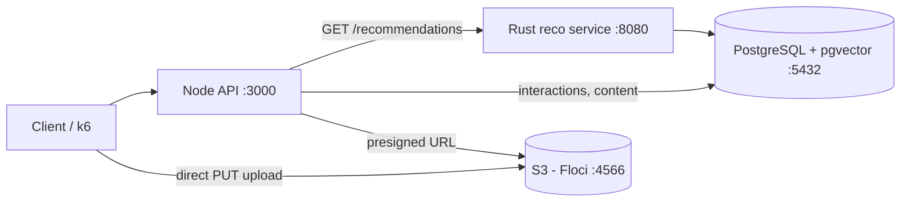

# The Social Network: content recommendations for creators

A social network backend that recommends creators' content by **vector similarity**.
A **Rust** service finds each user's nearest content with **PostgreSQL + pgvector**, a **Node.js** API handles
interactions and content, and media files go straight to **S3** through presigned URLs.

Built as a local MVP in 8 one-hour sessions ([plan](docs/PLAN.md)). Everything runs on Docker; S3 is emulated with
[Floci](https://github.com/hectorvent/floci).

## Results

Measured locally with 100,000 content items and 10,000 users ([details and how to reproduce](docs/results.md)).

| What | Result |
| --- | --- |
| Nearest-neighbor query, no index | 36.8 ms |
| Nearest-neighbor query, HNSW index | **3.9 ms** (9.4x faster) |
| Top-10 hits in the user's preferred category | **100%** vs 5% random |
| Highest load meeting p95 < 150 ms, p99 < 200 ms, 0 errors | **400 req/s** (p99 19.3 ms) |
| Saturation point | ~800 req/s (p99 281 ms, no errors) |
| Collapse | 1,000 req/s (throughput falls to 615 req/s, 1.13% errors) |
| Tests | 4 Rust unit tests, 4 Node integration tests |

The quality number comes from synthetic data with perfectly separated categories: it shows the pipeline works end
to end, not real-world quality. The load test shares one laptop between k6 and all services.

## How it works



**Recommendations** (`GET /recommendations/{userId}`, Rust):

1. **Profile:** the average vector of the content the user liked or shared (`AVG(embedding)` in SQL).
2. **Candidates:** pgvector returns the 50 nearest unseen items by cosine distance, using an HNSW index.
3. **Re-ranking:** best score first, at most 2 items per creator, 10 results (pure function, unit tested).
4. **Cold start:** users without likes get the most liked content of the last 24 hours.

**Uploads:** the API signs a 10-minute PUT URL, the client uploads directly to S3, then `POST /content` checks the
file exists and registers it. Large files never pass through the API.

## API

| Method | Path | Description |
| --- | --- | --- |
| `GET` | `/health` | Database check |
| `GET` | `/recommendations/:userId` | 10 recommendations (`personalized` or `trending`), proxied to Rust |
| `POST` | `/interactions` | `{ userId, contentId, type: view \| like \| share }`, idempotent |
| `GET` | `/content/:id` | One content item |
| `POST` | `/uploads/presign` | `{ creatorId, filename, contentType }` -> `{ url, key, expiresIn }` |
| `POST` | `/content` | `{ creatorId, title, category, key }`, registers an uploaded file |

## Getting started

Requirements: Docker Desktop and VS Code with the **Dev Containers** extension (it ships Rust, Node 22, Terraform
and the AWS CLI).

1. Open the folder in VS Code and choose **Reopen in Container**. This starts PostgreSQL (schema and synthetic data
   load automatically on first start) and Floci.
2. Create the bucket: `cd src/infra && terraform init && terraform apply`
3. Start the services, each in its own terminal:

```bash
cd src && cargo run --release            # Rust recommendation service on :8080
cd src/api && npm install && npm start   # Node API on :3000
```

4. Try it:

```bash
curl localhost:3000/recommendations/42
```

Without the dev container, `docker compose up -d` starts only PostgreSQL and Floci (copy `.env.example` to `.env`).

### Tests and measurements

```bash
cd src && cargo test                              # Rust unit tests
cd src/api && npm test                            # Node integration tests (Rust service must be running)
psql "$DATABASE_URL" -f db/explain.sql            # query plan and timing
psql "$DATABASE_URL" -f db/quality.sql            # recommendation quality vs random
k6 run -e RATE=400 loadtest/k6.js                 # load test at a fixed rate
```

## Key decisions

- **Rust only for the hot path.** Recommendations are called on every feed load; the general API stays in Node,
  where development speed matters more than raw performance.
- **Search in the database, not in memory.** pgvector's HNSW index does the nearest-neighbor search inside
  PostgreSQL; Rust only re-ranks 50 candidates.
- **`hnsw.ef_search = 100`.** With the default of 40, `LIMIT 50` came back with about 40 rows once seen items were
  filtered out.
- **16-dimension category vectors instead of language-model embeddings**, to fit the time box. The index, operators
  and query path are the same ones real embeddings would use.
- **Floci instead of LocalStack**, which requires an account and auth token since March 2026.
- **`shm_size: 512mb` for PostgreSQL:** Docker's default 64 MB `/dev/shm` breaks parallel HNSW index builds.

More in [docs/PLAN.md](docs/PLAN.md#decisions-and-findings).

## Project structure

| Path | Contents |
| --- | --- |
| `src/` | Rust crate root (`Cargo.toml`) |
| `src/src/` | Rust service: `main.rs`, `repository.rs`, `recommendation_engine.rs`, `models.rs`, `error.rs` |
| `src/api/` | Node.js API (Express) and its tests in `test/` |
| `src/infra/` | Terraform for the S3 bucket |
| `src/lambda/` | Original Lambda skeleton (phase 2) |
| `db/` | Schema, seed, and the `explain.sql` / `quality.sql` measurement scripts |
| `loadtest/` | k6 load test |
| `docs/` | [Plan](docs/PLAN.md), [results](docs/results.md), [original requirements](docs/original-requirements.md) |
| `.devcontainer/` | Development environment |

## Next steps (phase 2)

In progress: AWS deployment, see [docs/PHASE2.md](docs/PHASE2.md).


1. Profile the load test to find whether Node, Rust or PostgreSQL saturates first.
2. Real embeddings of title and description (for example `fastembed`, 384 dimensions).
3. Rust and Node as Lambdas behind API Gateway, with full Terraform.
4. AWS deployment (RDS PostgreSQL + RDS Proxy) and a 2,000 req/s load test from EC2.
5. Vue 3 UI and per-creator engagement metrics.
