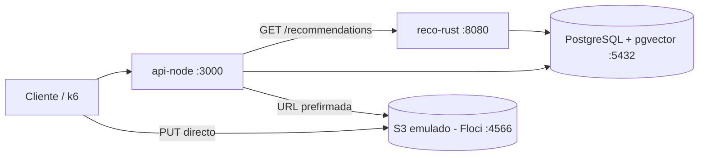

# The Social Network: red social para creadores de contenido

Plataforma que recomienda contenido de creadores usando similitud de vectores.
Motor de recomendaciones en **Rust** sobre **PostgreSQL + pgvector**, API en **Node.js** y archivos multimedia en **S3**.

> En construccion: MVP local de 8 sesiones. El plan esta en el documento "Plan de 8 dias".

## Arquitectura



## Requisitos

- Docker Desktop
- VS Code con la extension **Dev Containers** (recomendado: trae Rust, Node 22, Terraform, AWS CLI, tflocal y awslocal)
- Sin devcontainer: instalar Rust (rustup), Node.js 22, Terraform + tflocal y AWS CLI + awslocal a mano
- k6 (dia 8)

## Arranque

**Opcion A, devcontainer (recomendada):** abrir la carpeta en VS Code y elegir *Reopen in Container*.
Levanta `dev`, `postgres` y `floci`; dentro del contenedor las variables de entorno ya apuntan a `postgres` y `floci`.

**Opcion B, solo servicios:**

```bash
cp .env.example .env          # en PowerShell: Copy-Item .env.example .env
docker compose up -d
docker compose ps             # postgres "healthy" y floci arriba
```

La primera vez, Postgres crea el esquema y carga datos sinteticos (`db/`), unos 10 a 30 segundos.
Para empezar de cero: `docker compose down -v && docker compose up -d`.

Comprobar los datos:

```bash
docker exec -it tsn-postgres psql -U tsn -d tsn -c "select count(*) from content;"
```

## Estructura

Respeta la estructura del proyecto original; `db/` y `docs/` son adiciones.

| Ruta | Contenido |
| --- | --- |
| `.devcontainer/` | Entorno de desarrollo (Rust, Node 22, Terraform, AWS CLI) |
| `docker-compose.yml` | PostgreSQL 17 + pgvector y emulador S3 (Floci) |
| `db/` | Esquema y seed (se ejecutan al crear el contenedor de Postgres) |
| `src/` | Raiz del crate de Rust (`Cargo.toml` se crea el dia 2) |
| `src/src/` | Motor de recomendaciones (`recommendation_engine.rs`) |
| `src/lambda/` | Punto de entrada Lambda en Rust |
| `src/api/` | API en Node.js (Express) |
| `src/infra/` | Terraform (`main.tf`) |
| `loadtest/` | Pruebas de carga con k6 |
| `docs/` | Requerimientos originales |

Los archivos de `src/` y `loadtest/` son el esqueleto original y todavia no compilan; se corrigen segun el plan
(motor y Lambda: dias 2 a 4, API: dia 5, Terraform: dia 6, k6: dia 8).

## Resultados

Pendiente (dias 7 y 8): latencia con y sin indice HNSW, calidad de las recomendaciones frente al azar y resultados de k6.
