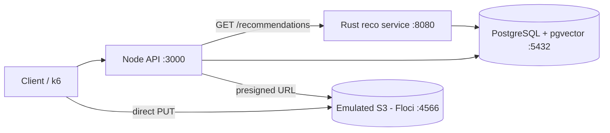

# The Social Network: a social network for content creators

A platform that recommends creators' content using vector similarity.
Recommendation engine in **Rust** on top of **PostgreSQL + pgvector**, API in **Node.js**, and media files in **S3**.

> Work in progress: an 8-session local MVP. See the [8-day plan](docs/PLAN.md) for scope, progress and next steps.

## Architecture



## Requirements

- Docker Desktop
- VS Code with the **Dev Containers** extension (recommended: ships Rust, Node 22, Terraform and the AWS CLI)
- Without the dev container: install Rust (rustup), Node.js 22, Terraform and the AWS CLI manually
- k6 (day 8)

## Getting started

**Option A, dev container (recommended):** open the folder in VS Code and choose *Reopen in Container*.
It starts `dev`, `postgres` and `floci`; inside the container the environment variables already point to `postgres` and `floci`.

**Option B, services only:**

```bash
cp .env.example .env          # PowerShell: Copy-Item .env.example .env
docker compose up -d
docker compose ps             # postgres "healthy" and floci running
```

On first start, Postgres creates the schema and loads synthetic data (`db/`), which takes 10 to 30 seconds.
To start from scratch: `docker compose down -v && docker compose up -d`.

Check the data:

```bash
docker exec -it tsn-postgres psql -U tsn -d tsn -c "select count(*) from content;"
```

## Project structure

Follows the original project structure; `db/` and `docs/` are additions.

| Path | Contents |
| --- | --- |
| `.devcontainer/` | Development environment (Rust, Node 22, Terraform, AWS CLI) |
| `docker-compose.yml` | PostgreSQL 17 + pgvector and S3 emulator (Floci) |
| `db/` | Schema and seed (run when the Postgres container is first created) |
| `src/` | Rust crate root (`Cargo.toml` is created on day 2) |
| `src/src/` | Recommendation engine (`recommendation_engine.rs`) |
| `src/lambda/` | Rust Lambda entry point |
| `src/api/` | Node.js API (Express) |
| `src/infra/` | Terraform (`main.tf`) |
| `loadtest/` | k6 load tests |
| `docs/` | [8-day plan](docs/PLAN.md) and [original requirements](docs/original-requirements.md) |

The Rust service in `src/src/` works (days 2 to 4). `src/api`, `src/infra`, `src/lambda` and `loadtest/` still hold the
original skeleton and are fixed following the [plan](docs/PLAN.md) (API: day 5, Terraform: day 6, k6: day 8; Lambda: phase 2).

## Results

Pending (days 7 and 8): latency with and without the HNSW index, recommendation quality versus random, and k6 results.
