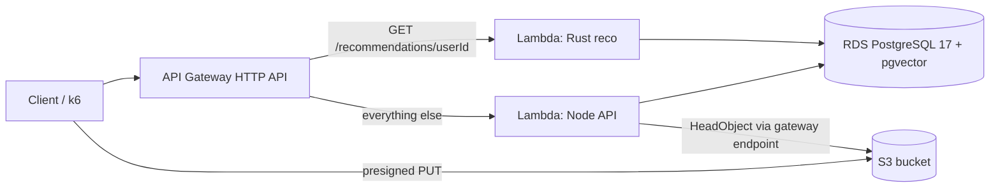

# Phase 2: AWS deployment (4 days)

Deploy the MVP to real AWS in **4 sessions of 1 hour each** with a **budget of $5 USD**.
The same Rust and Node code runs as **AWS Lambda** functions behind **API Gateway**, with **RDS PostgreSQL + pgvector**
and a real **S3** bucket, all created with **Terraform** and destroyed at the end.

## Progress

| Day | Topic | Status |
| --- | --- | --- |
| 9 | AWS account guardrails and Lambda-ready code | Done |
| 10 | Terraform: RDS + pgvector, S3, networking; load the data | Done |
| 11 | Terraform: Lambdas + API Gateway; end-to-end smoke test | Done |
| 12 | Load test on AWS, results, `terraform destroy` | Done |

## Architecture on AWS

- **API Gateway does the routing.** `GET /recommendations/{userId}` goes straight to the Rust Lambda; every other
  route (`$default`) goes to the Node Lambda. Node no longer proxies recommendations in AWS.
- **Same code, two runtimes.** Rust uses `lambda_http` with the same axum router; Node wraps the same Express app
  with `serverless-http`. Locally, both still run as normal servers.

## Budget decisions

| Decision | Why |
| --- | --- |
| `us-east-1`, single-AZ `db.t4g.micro` (about $0.016/h), 20 GB gp3 | Smallest RDS that runs pgvector |
| RDS only exists from day 10 to day 12, then `terraform destroy` | RDS bills per hour whether it is used or not |
| Default VPC, **no NAT Gateway** | A NAT Gateway alone would cost more than the whole budget |
| S3 **gateway** VPC endpoint (free) | Lets the Node Lambda reach S3 from inside the VPC without NAT |
| API Gateway **HTTP API** (not REST API) | Cheaper and simpler; enough for routing to two Lambdas |
| Lambdas on **arm64** (Graviton) | Lower price per GB-second |
| k6 from the laptop at modest rates, **no EC2 load generator** | Fits the time box and the budget |
| AWS Budgets alert at $5 | Email before the budget is exceeded |

Expected cost: about $1 to $3 for RDS (instance, storage, public IPv4) over 2 days, plus cents for Lambda,
API Gateway and S3. Accounts created after July 15, 2025 get Free Tier credits that may cover it.

## Known shortcuts (documented, not hidden)

- **RDS is publicly accessible** but its security group only allows the Lambdas and your own IP (`/32`), so you can
  load the schema and seed with `psql`. Production would use a private subnet and a bastion or SSM.
- **The database password is passed as a Lambda environment variable** (generated by Terraform). Production would use
  Secrets Manager or IAM database authentication; both need extra VPC endpoints that cost money.
- **TLS to RDS without certificate verification** (`sslmode=require` / `no-verify`). Production would pin the RDS CA bundle.
- **No RDS Proxy.** Each Lambda instance opens at most 2 connections; `db.t4g.micro` allows about 80, which caps
  concurrency. This is expected to be the bottleneck of the load test, and measuring it is part of the point.

## Findings

- **Presigned URLs did not enforce the file type.** AWS SDK v3 does not sign `Content-Type` by default, so S3 accepted
  an `image/png` upload on a URL requested for `video/mp4`. Fixed with `signableHeaders: new Set(['content-type'])`;
  S3 now returns 403 on a mismatch. Only real S3 revealed it: the emulators accepted any type.
- **Smoke test timings (from the laptop in Mexico to `us-east-1`, one `curl` each):** Node cold start 2.08 s,
  Rust cold start 0.93 s, Rust warm 0.29 s (mostly network and TLS handshake; the Lambda itself ran in 18.7 ms).
- **Memory:** the Rust Lambda used 17 MB; the Node Lambda used 130 MB. Lambda bills memory x time, so the hot path
  (recommendations) is also the cheapest one.
- **RDS seed is slow with the HNSW index already in place:** the index is updated row by row on a 2 vCPU / 1 GB
  instance. For bulk loads, create the index after inserting the data.
- **Query on RDS:** the nearest-neighbor query ran in 4.7 ms on `db.t4g.micro` (3.9 ms on the laptop).
- **Load test: healthy up to 100 req/s, connection storm at 200 req/s.** Without RDS Proxy every new Lambda instance
  opens its own database connections; scale-out drove Lambda concurrency to the account limit (400) and RDS to 206
  connections while its CPU stayed at 54%. Details in [results.md](results.md#aws-deployment-phase-2).

## Day 9: Guardrails and Lambda-ready code (60 min)

- [x] (10 min) AWS Budgets: monthly cost budget of $5 with email alerts at 50% and 100%.
- [x] (5 min) Service Quotas -> AWS Lambda -> **Concurrent executions**: 400 on this account (increase to 1,000 requested).
- [x] (10 min) IAM user (or IAM Identity Center) with an access key; `aws configure --profile tsn`; check with `aws sts get-caller-identity --profile tsn`. Inside the dev container, `unset AWS_ENDPOINT_URL` for AWS sessions (it points to Floci).
- [x] (15 min) Rust: `lambda_http` runs the same axum router when `AWS_LAMBDA_RUNTIME_API` is set; TLS feature for sqlx; pool size from `DB_MAX_CONNECTIONS`. Build with `cargo lambda build --release --arm64 --output-format zip`.
- [x] (15 min) Node: `lambda.js` handler with `serverless-http`; pool size and SSL from environment variables; production-only zip.
- [x] (5 min) Both still run locally (`cargo run`, `npm start`, `npm test`).

**Done when:** budget alert active, Lambda quota known, and both zip files built.

## Day 10: Data and storage (60 min)

- [x] (15 min) `src/infra/aws/`: provider (`us-east-1`, profile `tsn`), default VPC and subnets, security groups (Lambda SG, RDS SG allowing 5432 from the Lambda SG and your IP).
- [x] (10 min) RDS PostgreSQL 17 `db.t4g.micro`, 20 GB gp3, single-AZ, no backups, `skip_final_snapshot`, random password.
- [x] (5 min) S3 bucket with a random suffix (bucket names are global), public access block, CORS; S3 gateway endpoint.
- [x] (15 min) `terraform apply` (RDS takes 5 to 10 minutes; read ahead while it runs).
- [x] (15 min) Load `db/01_schema.sql` and `db/02_seed.sql` with `psql` against the RDS endpoint; check counts and the HNSW index.

**Done when:** `psql` on RDS returns 100,000 content items and pgvector's version.

## Day 11: Compute and API (60 min)

- [x] (15 min) IAM roles: basic execution + VPC access for both Lambdas; `s3:PutObject` and `s3:GetObject` on the bucket for Node.
- [x] (15 min) Two Lambdas (arm64, in the default VPC with the Lambda SG) from the day 9 zip files; environment variables for the database, bucket and pool size.
- [x] (10 min) API Gateway HTTP API: `GET /recommendations/{userId}` -> Rust, `$default` -> Node; Lambda permissions; output the URL.
- [x] (20 min) Smoke test against the API URL: health, recommendations for user 42, idempotent like, presigned upload to the real bucket, content registration.

**Done when:** the full flow of days 3 to 6 works against the API Gateway URL.

## Day 12: Load test, results and teardown (60 min)

- [x] (25 min) k6 from the laptop with `-e BASE_URL=<api url>` at 25, 50, 100, 200 and 300 req/s (30 s each). Watch CloudWatch: Lambda duration, concurrent executions, throttles; RDS CPU and connections.
- [x] (15 min) `docs/results.md`: AWS section (latency including the network from Mexico, cold starts, where it saturates and why).
- [x] (10 min) README: AWS architecture and how to deploy.
- [x] (10 min) **`terraform destroy`**, then check in the console that RDS, Lambdas, API and bucket are gone, and look at Billing.

**Done when:** results documented, everything destroyed, and the bill is under $5.

## Rules

- **Never leave RDS running between phases without a reason.** If day 11 or 12 is delayed by more than a day,
  destroy and re-create (the data loads in a few minutes).
- Commit at the end of every session.
- Cut in this order if behind: the S3 upload in the day 11 smoke test, then CloudWatch analysis on day 12.
  **`terraform destroy` is never cut.**
